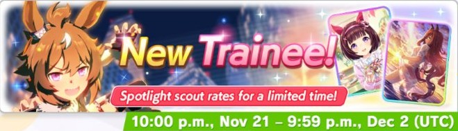
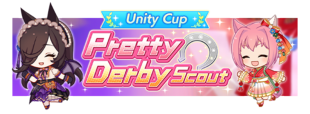
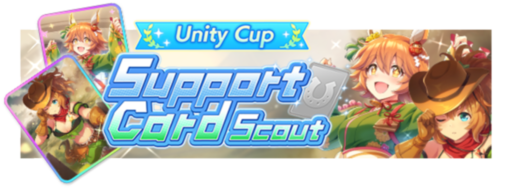
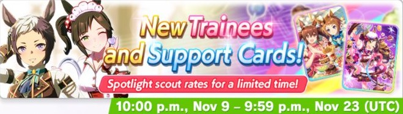

::: warning GACHA WAS A MISTAKE

**Faites attention à vous** lorsque vous décidez de faire des pulls.

Même si une bannière est importante, la réalité des gacha est pénible, et c'est pas dit que vous aillez des bons résultats. Vous avez **plus de chances d'avoir des mauvais résultats** que des bons, et c'est bien d'y être toujours préparé.

Les lois du hasard numérique n'ont rien à faire de votre humeur, et c'est souvent très frustrant de faire des pulls. **Les probabilités sont contre vous**, et le concept même de gacha joue sur notre incapacité à réaliser ça.

Gardez vos attentes in check pour ne pas être blessé·e·s. 

Et surtout bonne chance 🌟

----

#### Les review des bannières sont généralement postées entre 48h avant et 48h après la date de sortie des bannières !

:::

_Pour connaître les heures de début et de fin en France, il faut ajouter +2h._

# Review des bannières gacha actuelles et à venir

Sur cette page nous tenterons d'évaluer la qualité des bannières gacha actuelles ; vous y trouverez une review des **bannières umamusume** et **bannières cartes support**. Le but est de vous aider à faire des pulls pertinents, et à **maximiser la valeur ajoutée des carats que vous dépensez !**

::: warning Auteurs

Sauf mention contraire, les reviews sont écrites **Kamuisaki** et vérifié par **Yamakyu**, n'hésitez pas à nous faire des retours 🌟

Bien que nous fassions de notre mieux pour vous proposer des conseils pertinents, **nous avons aussi des BIAIS, et nous faisons des erreurs**. N'hésitez pas à double-check ces recommandations auprès d'autres vétérans ; des tas de gens font des recommandations de pull, surtout dans la commu anglophone.

:::

Il est bon de rappeler que **Umamusume est un jeu de cartes**, et que comme tout jeu de cartes, **il faut avoir des cartes** pour bien jouer. Si vous faites abondamment des pulls sur les bannières umamusume, _vous allez ralentir votre progression_. Mais c'est un choix acceptable que vous pouvez faire, chacun ses objectifs. On le rappelle assez peu ces derniers temps, mais il est bon de rappeler que **votre fun est _plus important_ que les recommandations**.

Quel que soit vos résultats en gacha, n'oubliez pas que les cartes/uma en question deviennent dispo dans le pool général : vous pourrez en obtenir des **LB supplémentaires plus tard** par chance, et on aura plus tard une ressource (à farmer durement) pour **augmenter les LB** des cartes de notre choix ! 

:::: tip Faites des pulls SI VOUS AVEZ UN SPARK

Il est très **fortement déconseillé** de faire des pulls sur une bannière (n'importe laquelle) si vous avez moins d'un spark, c'est à dire, **moins de 200 pulls** (en carats + tickets cumulés). Ça représente **30 000** :carat:, moins 150 carats pour chaque **ticket _rose_** possédé (les autres tickets ne contribuent pas à votre spark). Si vous n'avez pas ces ressources, vous êtes à **grand risque** de dépenser vos précieux carats (durement acquis, vu comme le jeu n'est *pas* généreux actuellement) _sans **RIEN** OBTENIR pour autant_.

::: warning Si vous venez _juste_ de débuter

C'est correct de faire des pulls sur une **bannière de cartes support** avec moins d'un spark, car vous avez besoin de monter un peu vos SR. Mais **seulement si vous venez juste de débuter**. Quand vous commencez à avoir **les bonnes SR montées à 2-3LB** ou mieux, là vous voulez viser des bannières spécifiques en ayant un spark.

On ne le rappellera jamais assez mais, oui, **les cartes SRs sont _bonnes_** (vraiment) dans Umamusume Pretty Derby. À terme vous voulez des bonnes SSR MLB, mais en attendant vous aurez tout le loisir d'exploiter le potentiel des nombreuses bonnes cartes SRs du jeu.

:::

Pour les bannières de très grande importance, on essaie même de **viser 2 sparks**.

C'est une véritable **épreuve de patience**, c'est normal que ça vous paraisse long. On ne pull pas souvent dans Umamusume sadly. Et si vous forcez en essayant de faire des pulls avec trop peu de ressources, vous serez déçu la majorité du temps. It just be like this.

::::

::: danger Vocabulaire

Si vous avez des doutes sur le vocabulaire utilisé, n'hésitez pas à [**consulter le glossaire**](/guides/FAQ/glossary.md) !

:::

Bonne chance à tous·tes !

---

# Nouvelle bannière actuelle

### Bannière Umamusume : Shunko Windy ★★★

⏩ **Shunko Windy** :

_Shinko Windy est une Pace Chaser pour le Mile Dirt. Avec de l’inspiration, elle peut courir en Medium et en Sprint mais aussi en tant que Late Surger. (1 :star: pour le Medium et Late Surger, 4 :star: pour le Sprint). Elle possède un gold de vélocité pour le Dirt et un gold green pour le Dirt. Son unique est un boost hybride de vélocité et d’accélération._
 
- Elle possède 3 bonus de croissance : 10% en :speed:, 10% en :power: et 10% en :guts:. C’est un très bon combo, le meilleur combo possible avec du Guts. Cela fait qu’elle est potentiellement intéressante avec un deck Guts. Sinon elle utilisera un deck basique.
 
- Ses gold skills sont :
 
    - **Full Speed**, la gold version de _Full Tilt_. C’est un gold de vélocité pour le Dirt. Il s’active aléatoirement en Last Spurt si l’utilisatrice est dans le top 50% et en mécanique de Last Spurt. 
    La durée du skill est plus haute que la moyenne, mais son activation aléatoire en Last Spurt est une mauvaise chose. Le skill peut-être excellent, tout comme mauvais s’il s’active trop tard.
 
    - **Maestro of the Mud**, la gold version de _Muddy_. C’est un gold green pour le Dirt, s’activant dans les courses avec le Heavy ou Bad Track condition. Le skill donne 60 de Speed et Power. 
    Le skill est fort sur les courses où il s’active, bien que cher sans hints pour Muddy.
 
- Un des évènements de ses Costume Event peut lui donner Fast Learner, ce qui lui donne 2 chances de le recevoir par carrière.
 
- Elle possède 2 Secret Events :

    - Le premier est lié au fait de gagner Zen-Nippon Junior Yushun, M.C. Nambu Hai, February Stakes et Kashiwa Kinen. En récompense, elle reçoit 20 en Power et Speed, 30 Skill Points et des hints pour _Top Pick_. Afin de faire ce Secret Event, elle devra faire 3 courses en plus, seul February Stakes est dans sa carrière.

    - Son deuxième s’active si pendant sa carrière, l’évènement **_The Big Prank Plan, Launched !_** s’active. Elle recevra du Speed et Power, et potentiellement de l’énergie et des hints pour _Forward, March !_
 
Son unique, _**Ding Dong, Boo !**_, est un boost hybride de vélocité et d’accélération. L’unique s’active si elle fait au moins un Duelling. Sur les courses Turf, l’unique ne possède pas le boost d’accélération. 
L’unique est très situationnel, l’unique ne peut s’activer que sur la ligne droite finale. Ce n’est pas un très bon unique.

#### Pull ou pas ? :

Non, à moins qu’elle soit votre Oshi
 
Shinko Windy n’est pas très bonne et plutôt situationnel. Surtout que de bien meilleures uma Dirt sont sorties avant elle.

---

### Bannière support : Maruzensky Speed SSR & Nishino Flower Wit SSR (rerun)

⏩**Maruzensky** :speed: :SSR:

[Vous pouvez retrouver les informations de la carte ici](/guides/Gacha-was-a-mistake/archives/Support-gacha-reviews-2026.md#_52-maruzensky-speed-ssr-nakayama-festa-wit-ssr)

⏩**Nishino Flower** :wit: :ssr:

[Vous pouvez retrouver les informations de la carte ici](/guides/Gacha-was-a-mistake/archives/Support-gacha-reviews-2026.md#_34-sakura-bakushin-o-guts-ssr-nishino-flower-wit-ssr)

#### PULL OU PAS

La seule carte intéressante est Maruzensky Speed SSR. Elle est à pull seulement si vous jouez Front Runner ou si vous ne possédez qu’une seule carte META en Speed. Vous aurez juste à viser LB1 et cela sera suffiasant.

Dans les autres cas, skippez la bannière.

---

::: danger Review à partir de Grand Master

Il y a quelques changements dans les reviews à partir de maintenant.

Pour les reviews des Umamusumes, il y a maintenant l'ajout de leur skills évolués. Afin d'avoir le meilleur rendu possible, n'hésiter pas à nous donnez vos avis si vous avez d'autres préférences pour l'affichage des skills évolués.

Pour les reviews des cartes Support, le changement est de notre côté. Les reviews vont devenir plus sévères avec les supports. Ceci est dû au fait que Grand Master est le dernier scénario avec 2 cartes Wit et le premier scénario où on utilise réelement que 2 cartes Speed. Ce changement s'applique surtout sur les cartes Wit, les autres types vont garder la même dureté de review qu'elle possédé déjà.
Il y aure des cartes Wit, bien que fortes, qui seront jugé à moins importantes dû qu'elle aurait une durée de vie réduite dès le prochain scénario.

:::

# Bannières à suivre (02 Décembre 23h)  

<!--  -->

### Bannière Umamusume à suivre : Mr. C.B & Twin Turbo ★★★

⏩ **Mr. C.B** :

_Mr. C.B est une End Closer pour le Medium et le Long. Elle peut aussi courir parfaitement en tant que Late Surger. Avec de l’inspiration, elle peut courir en Mile (1 :star:). Elle possède un gold de Current Speed pour le Medium / Long et un gold d’accélération d’End Closer. Son unique est un boost de vélocité de seconde moitié de Mid-Race._
 
- Elle possède 3 bonus de croissance : 10% en :speed:, 10% en :stamina: et 10% en :wit:. C’est un excellent combo, que ce soit en Medium ou Long. Elle utilisera généralement le deck basique de Grand Master : 2 Speed / 2 Wit / Ancestor / 1 Flex. Elle ne peut pas utiliser sa propre carte Wit, cela fait que ses cartes Wit seront généralement Mejiro Ramonu et Sweep Tosho. C'est un point négatif plutôt important.
 
- Ses gold skillls et skills évolués sont :
 
    - **Beautiful Form**, la gold version de _Break the Mold_. C’est un gold de Current Speed qui s’active aléatoirement sur le 3ème corner des courses Medium et Long si l’utilisatrice est en dehors du top 40% (≥4 en CM et ≥5 en LoH). 
    Le skill est très puissant et aura toujours une forte utilité. Il dure un peu plus longtemps que les skills gold de vélocité basique. 
    Mr. C.B possède une évolution pour ce gold skill
 
    - _**Soaring Steps**_ est l’évolution de Mr. C.B pour son gold skill **Beautiful Form**. L’évolution améliore la puissance du boost de Current Speed.
 
    ::: details Obtention
 
    - Gagner le Triple Crown (Satsuki Sho, Tokyo Yushun, Kikuka Sho) ou posséder au moins 2 skills d’accélération 
    - Avoir au moins 150 000 fans.
 
    ::: 

    - **Encroaching Shadow**, la gold version de Straightaway Spurt. C’est un gold d’accéléraion d’End Closer, s’activant en ligne droite si l’utilisatrice rentre en Last Spurt Mode. 
    Le skill est excellent, surtout en Long où il s’active sur toutes les courses. C’est l’outil d’accélération principal pour les End Closer et n’est pour l’instant pas obtenable avec un support. 
    Mr. C.B possède deux évolutions pour ce gold skill.

    - **_Spring from the Earth_** est l’une des évolutions de Mr. C.B pour son gold skill **Encroaching Shadow**. L’évolution lui donne un boost de Field of View. Le boost est inutile.

    ::: details Obtention
 
    - Posséder au moins 4 skills d’End Closer.
    - Avoir au moins 800 Wit.
 
    :::

    - _**Dancing Flourish**_ est l’autre évolution de Mr. C.B pour son gold skill **Encroaching Shadow**. Le skill modifie son activation et se spécifie pour les courses Medium. Le skill évolué possède 2 activations différentes :  
    Dans le premier cas, si le premier quart du Late-Race se trouve sur une ligne droite, le skill s’active immédiatement.
    Dans le deuxième cas, si le premier quart du Late-Race ne se trouve pas sur une ligne droite, l’activation devient aléatoire sur cette portion. 
    L’évolution est très bonne, car Encroaching Shadow ne s’active pas si le Late-Race ne se trouve pas sur une ligne droite. Cela lui permet d’être utilisable dans tous les Medium.
 
    ::: details Obtention
 
    - Avoir au moins 2 skills pour le Medium
    - Avoir au moins 800 Speed.
 
    :::
 
- Mr.C.B possède 2 Secret Events :

    - Le premier lui demandera de gagner la Japan Cup et Arima Kinen de l’année classique. Cela veut dire de faire 2 courses en plus. Elle reçoit en récompense 25 de Speed et Guts, 20 Skill Points et des hints pour _Breakin’ Out_.

    - Le second s’active si pendant l’évènement « A Little Love Story » vous prenez le second choix et que vous gagnez une course qui ne fait pas partie de ses objectifs. Ce Secret Event peut se combiner avec le premier. Elle reçoit en récompense 15 d’énergie, 10 de Power et des hints pour Ramp Up. 
    Si l'évènement « A Little Love Story » s’active avant la Japan Cup ou Arima Kinen de l’année classique, il est rentable de faire ces 2 courses en plus.
 
- Elle possède aussi 2 white skills importants, _Uma Stan_ qui provient de ses skills à éveillés et _Tail Held High_ qui provient d’un de ses évènements.
 
- Son unique, _**Lyrical Journey**_, est un boost de vélocité de durée accrue et de puissance réduite. La puissance de l’unique dans les courses Medium et Long s’améliore un peu si Mr. C.B se trouvent 20 mètres derrière l’uma en première place. 
L’unique s’active en seconde moitié de Mid-Race si Mr. C.B se trouvent en dehors du top 50% (≥5 en CM et ≥ en LoH). 
L'unique est très bon, et lui permet de rattraper le peloton avant le Late-Race.

⏩ **Twin Turbo** :

_Twin Turbo est une Front Runner pour le Mile et le Medium. Elle possède un gold de vélocité de Front Runner et un gold d’accélération de Front Runner. Son unique est un boost de vélocité de forte durée et un debuff faible de Current Speed pour Twin Turbo en Last Spurt._
 
- Elle possède un bonus de croissance : 30% en :speed:. Ce n’est pas si fort que ça. On utilise déjà 2 cartes Speed, ce qui est suffisant pour atteindre le cap. On essayera de la jouer avec une seule carte Speed / 2 Wit / Ancestor et 2 cartes Flex, principalement Guts.
 
- Ses gold skills et skills évolués sont :
 
    - **Giving It 1 000%**, la gold version de _Mad Dash_. C’est un gold skill de vélocité de Front Runner, qui donne un gros boost pour une forte consommation d’HPs (consomme plus qu’un gold skill de debuff d’HPs mais moins qu'un gold skill de recovery). Le skill dure un peu plus longtemps que les skill de vélocité basique. Le skill s’active aléatoirement dans la première partie du Mid-Race. Cette zone d'activation peut l'aider à sécuriser le lead contest. 
    Twin Turbo possède une évolution pour ce gold skill.
 
    - _**1 000% Output !**_ est l’évolution de Twin Turbo pour son gold skill **Giving it 1 000%**. L’évolution améliore la puissance du skill.
 
    ::: details Obtention
 
    - Dans l’évènement « Turbo Engine, Limit Break !! », prenez le premier choix ou avoir au moins 800 Speed
    - Obtenir le skill Runaway ou posséder au moins 2 skills de Front Runner.

    :::
 
    - **Taking the Lead**, la gold version d’_Early Lead_. C’est un gold d’accélération pour Front Runner. Il s’active dès le début de la course. 
    C’est un très bon skill, les Front Runners ont besoin de beaucoup d’accélération au début de la course pour prendre la première place. Cela lui libère aussi le fait de devoir prendre Mihono Bourbon Wit pour soit prendre une meilleure stats stick ou un autre skill gold. 
    Twin Turbo possède une évolution pour ce gold skill.
 
    - _**Turbo’s Leadin’ the Charge !**_ est l’évolution de Twin Turbo pour son gold skill **Taking the Lead**. L’évolution améliore la puissance du skill.
 
    ::: details Obtention
 
    - Gagner 3 courses Graded en tant que Front Runner
    - Posséder au moins 2 skills d’accélération
 
    :::
 
- Twin Turbo possède 4 Secret Events :
 
    - Le premier consiste à gagner le Satsuki Sho. C’est une course qui n’est pas dans ses objectifs. Elle reçoit en récompense 10 dans une stat aléatoire, 75 Skill Points et des hints pour _Up-Tempo_ pour un coût de 15 énergies.
 
    - Le second consiste à gagner le Tokyo Yushun. C’est aussi une course qui n’est pas dans ses objectifs. Les récompenses sont similaires au premier, avec juste les hints pour Up-Tempo remplacé par _Rosy Outlook_.
 
    - Le troisième consiste à gagner le Tanabata Sho. C’est une course dans ses objectifs. En récompense, elle reçoit 3 dans quatres stats aléatoires, 30 Skill Points et un hint pour _Runaway_. Il est important pour l’évolution de l’un des gold skills.
 
    - Le dernier lui demande de gagner l’Arima Kinen (Senior).  C’est une course dans ses objectifs. En récompense, elle reçoit 1 dans toutes les stats, 50 Skill Points, et des hints pour _Deep Breath_ et _Nakayama Racecourse_.
 
    Outre le 3ème Secret Event, aucun n’est vraiment intéressant.
 
- Son unique, _**Turbo BLAST !**_, est un boost de vélocité de forte durée (13 secondes de durée de base) et faible puissance. Il est aussi un debuff faible de Current Speed pour Twin Turbo à partir du Last Spurt. L’unique s’active à 35% de distance de course si Twin Turbo est en tête et qu’il y est un écart d’au moins 1L avec l’uma en deuxième position. Le debuff de Current Speed s’active seulement si elle a activé la première partie de l’unique. 
L’unique n’est pas très fort, elle ne prendra généralement pas assez d'avance en Mid-Race, et elle était déjà plus lente que les umas dans les autres stratégies en Last Spurt.

#### Pull ou pas ? :

Si l’une d’elle est votre Oshi ou que vous jouez des End Closers, oui.
 
Mr. C.B est une très bonne uma, l’une des meilleures End Closer sortie depuis le début. Elle est normalement meilleure que Narita Taishin, mais sa propre carte et son gold skill Daring Strike fait que Narita Taishin reste meilleure. Elle devra attendre au moins la prochaine Narita Taishin Wit pour devenir meilleure qu’elle.
 
Twin Turbo est de base une uma 1 étoile, donc il n’est pas nécessaire de pull pour elle immédiatement. Ses gold skills sont bons, mais en dehors de ça, elle est plutôt faible.

Pullez en fonction de votre besoin pour Mr. C.B.

### Bannière Support à suivre : Mejiro Ramonu Wit SSR, Agnes Tachyon Power SR, Symboli Rudolf Stamina SR, Mejiro Dober Guts SR & Jungle Pocket Speed SR

⏩**Mejiro Ramonu** :wit: :SSR:

_Mejito Ramonu Wit SSR est une carte Semi-Spécialiste pour le Mile/Medium._
 
- La carte est backloaded. A 1LB, elle débloque Skill Point Bonus puis Wit Bonus à 3LB et un second Wit Bonus à MLB.
 
- Son Unique Effect lui donne 4 de Training Effectiveness pour chaque skill de vélocité posséder par l’uma, jusqu’à un total de 20 de Training Effectiveness. C’est un Unique Effect puissant mais non optimal. Vous aurez besoin de prendre des skills avant la fin de la run, le plus tôt possible. Cela veut dire que les skills que vous prendrez ne seront pas affectés pour un potentielle Fast Learner.
 
- Ses rainbows sont très bons avec son bon Friendship Bonus et son Special Priority correct, amplifié par son Unique Effect et ses Stats Bonus. Son cross-training est aussi très bon avec son Unique Effect et ses Stats Bonus.
 
- Elle propose une liste de 9 hints❗, principalement pour le Mile et le Medium, et le bon _Straightaway Adept_. Elle possède un Hint Level parfait et excellent Hint Frequency. Ses hints seront toujours excellents et sont utiles pour son Unique Effect.
 
- Son gold skill est **Superb Gait**, la gold version de _Graceful Gait_. C’est un gold skill de vélocité pour le Mile/Medium, s’activant aléatoirement en Mid-Race.
C’est un bon gold skill basique.

⏩**Agnes Tachyon** :power: :sr:

- La carte est backloaded. A 1LB, elle débloque le combo de Hint Level et Hint Frequency puis Skill Point Bonus à MLB.
 
- Son Unique Effect lui donne du Power Bonus et 15 d’Initial Friendship Gauge.
 
- Ses rainbows sont faibles. Elle possède un bon Friendship Bonus et un faible Special Priority. Ils sont un peu amplifiés par ses Stats Bonus. L’absence de Training Effectiveness fait vraiment mal à la carte. 
Son cross-training est basiquement inexistant avec seulement ses Stats Bonus.
 
- Elle propose une liste de 9 hints❗, principalement de Pace Chaser et pour le Medium, et l’excellent _Risky Business_. Elle possède un bon Hint Level et Hint Frequency, ses hints seront sympas.
 
- Son premier Chain Event lui donne _Risky Business_. Son dernier Chain Event nous propose de soit prendre 10 énergies, soit de perdre 15 de Power pour 40 de Speed ou l’inverse, perdre 15 de Speed pour 40 de Power.

⏩**Symboli Rudolf** :stamina: :sr:

- La carte est backloaded. A 1LB, elle obtient le combo Race Bonus et Fan Bonus puis Skill Point Bonus à MLB.
 
- Son Unique Effect lui donne 10 de Friendship Bonus et du Stamina Bonus. Cela fait que son Friendship Bonus est en réalité plus élevé que ce que la carte montre. Elle possède 32 de Friendship Bonus.
 
- Ses rainbows sont bons avec ses bons Friendship Bonus et Special Priority, un peu amplifié avec son faible Training Effectiveness et ses Stats Bonus. Elle est un poil moins forte que Mayano Top Gun Stamina SR. 
Son cross-training est faible avec son faible de Training Effectiveness et ses Stats Bonus.
 
- Elle propose une liste de 8 hints❗, principalement pour le Long et skills de debuff. Elle possède un bon Hint Level et Hint Frequency, ses hints seront sympas.
 
- Son dernier Chain Event propose soit _Corner Recovery_ ou _Right Handed_ en fonction de votre choix du premier Chain Event. Le premier choix vous donnera Corner Recovery et le second vous donnera Right Handed.

⏩**Mejiro Dober** :guts: :sr:

- La carte est backloaded. A 1LB, elle obtient du Training Effectiveness puis Guts Bonus à MLB.
 
- Son Unique Effect lui donne 5 de Training Effectiveness et 5 de Race Bonus.
 
- Ses rainbows sont assez bons, malgré son Friendship Bonus correct et son faible Special Priority, grâce à son bon Training Effectiveness et son Guts Bonus. Ses rainbows sont de même puissance que K.S. Miracle Guts SR. 
Son cross-training est bon grâce à son bon Training Effectiveness. C’est le meilleur des cartes Guts SR en cross-training.
 
- Elle propose une liste de 6 hints, principalement pour le Medium. Elle possède un très bon Hint Level et Hint Frequency. Ses hints seront puissants.
 
- Son dernier Chain Event donne _Kyoto Racecourse_.

⏩**Jungle Pocket** :speed: :sr:

- La carte est backloaded. A 1LB, elle obtient du Mood Effect puis Power Bonus à MLB.
 
- Son Unique Effect lui donne 10 de Friendship Bonus et Skill Point Bonus. Cela fait que son Friendship Bonus est en réalité plus élevé que ce que la carte montre. Elle possède 37,5 de Friendship Bonus.
 
- Ses rainbows sont du même niveau que les autres cartes Speed SR, avec son très bon Friendship Bonus et son faible Special Priority, un peu accentué avec ses Stats Bonus. 
Son cross-training est inexistant en dehors de ses Stats Bonus.
 
- Elle propose une liste de 7 hints❗, principalement de Late Surger et d’End Closer. Elle possède un bon Hint Level et du Hint Frequency. Ses hints seront sympas.
 
- Son dernier Chain Event vous donne le choix de prendre 20 d’énergie et du Mood ou de prendre _Straightaways Spurt_.

#### PULL OU PAS

Les cartes SR sont peu intéressantes, on va se concentrer sur Mejiro Ramonu Wit SSR.
 
Elle est pour l’instant la meilleure carte Wit dans le jeu, bien que ce ne soit pas un gros power creep. Cependant, elle n’est pas aussi nécessaire à ce que plein de personnes disent. Son problème est d’être une carte Semi-Spécialiste et non Généraliste ou Spécialiste. Cela fait que son utilisation n’est pas aussi universelle que ses 2 cas, bien que le fait qu’elle se spécialise en Mile et en Medium, les 2 distances les plus communes reste très sympa. 
Elle dépend fortement des autres cartes Wit qui vont sortir pendant Grand Master et le prochain scénario, Projet l’Arc. En fonction de la stratégie, Mejiro Ramonu vous servira pendant un ½ scénario ou jusqu’ à 1 scénario et 2/3.
 
Les Front Runners sont ceux qui ont le moins besoin de Mejiro Ramonu avec les End Closers. Votre carte principale deviendra Mihono Bourbon (Pique-Nique) Wit SSR, qui sort peu de temps après Mejiro Ramonu. Leur seconde carte Wit pour Grand Master sera Aston Machan qui sort vers le milieu du scénario. La carte perd énormément de valeur dès Mihono Bourbon.
 
Les Pace Chasers et Late Surger seront ceux qui utiliseront la carte le plus longtemps, surtout les Late Surger. Les Pace Chasers peuvent garder Fine Motion Wit SSR pendant l’Arc, le premier scénario où on utilise une seule Wit, jusqu’à ce qu’elle se fasse remplacer par Mejiro McQueen Wit SSR. Les Late Surgers utilisent Mejiro Ramonu jusqu'à l'arrivée de Satono Diamond Wit SSR. Ce sont aussi 2 stratégies qui recevront une carte Ultra-Spécialisé pour le Long, ce qui peut sortir Ramonu de vos decks Long.
 
Les End Closers utiliseront Mejiro Ramonu seulement pendant Grand Master et que sur les CM Mile et Medium. Elles possèdent déjà leur carte Wit principale en Mr. C.B Wit SSR et une seconde carte Wit avec Sweep Tosho.
 
Le fait que Grand Master est le dernier scénario à 2 cartes Wit et l’existence de certaines cartes Wit, fait qu’il est préférable d’utiliser Mejiro Ramonu en tant que Borrow, au lieu de dépenser fortement pour la MLB.
 
Mejiro Ramonu Wit SSR est une excellente carte, mais ne possède pas nécessairement une durée de vie ou une puissance nécessaire pour dépenser autant de vos carats dedans.

### Vous pouvez consulter les archives des précédentes bannières

* [Bannières cartes support de 2026](/guides/Gacha-was-a-mistake/archives/Support-gacha-reviews-2026.md)
* [Bannières cartes support de 2025](/guides/Gacha-was-a-mistake/archives/Support-gacha-reviews-2025.md)
* [Bannières umamusume ★★★ de 2026](/guides/Gacha-was-a-mistake/archives/Uma-gacha-reviews-2026.md)
* [Bannières umamusume ★★★ de 2025](/guides/Gacha-was-a-mistake/archives/Uma-gacha-reviews-2025.md)

 
 
 

# 👏🏿 GACHA WAS A MISTAKE 👏🏿

