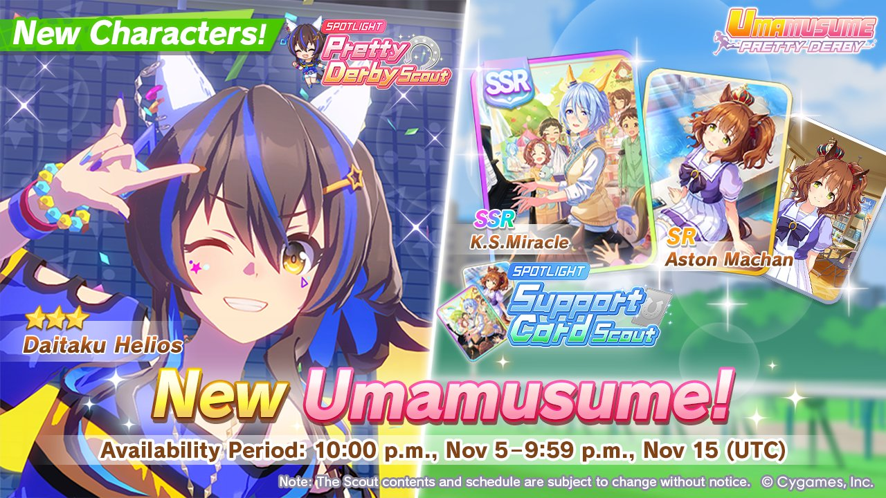

::: warning GACHA WAS A MISTAKE

**Faites attention à vous** lorsque vous décidez de faire des pulls.

Même si une bannière est importante, la réalité des gacha est pénible, et c'est pas dit que vous aillez des bons résultats. Vous avez **plus de chances d'avoir des mauvais résultats** que des bons, et c'est bien d'y être toujours préparé.

Les lois du hasard numérique n'ont rien à faire de votre humeur, et c'est souvent très frustrant de faire des pulls. **Les probabilités sont contre vous**, et le concept même de gacha joue sur notre incapacité à réaliser ça.

Gardez vos attentes in check pour ne pas être blessé·e·s. 

Et surtout bonne chance 🌟

----

#### Les review des bannières sont généralement postées entre 48h avant et 48h après la date de sortie des bannières !

:::

_Pour connaître les heures de début et de fin en France, il faut ajouter +2h._

# Review des bannières gacha actuelles et à venir

Sur cette page nous tenterons d'évaluer la qualité des bannières gacha actuelles ; vous y trouverez une review des **bannières umamusume** et **bannières cartes support**. Le but est de vous aider à faire des pulls pertinents, et à **maximiser la valeur ajoutée des carats que vous dépensez !**

::: warning Auteurs

Sauf mention contraire, les reviews sont écrites **Kamuisaki** et vérifié par **Yamakyu**, n'hésitez pas à nous faire des retours 🌟

Bien que nous fassions de notre mieux pour vous proposer des conseils pertinents, **nous avons aussi des BIAIS, et nous faisons des erreurs**. N'hésitez pas à double-check ces recommandations auprès d'autres vétérans ; des tas de gens font des recommandations de pull, surtout dans la commu anglophone.

:::

Il est bon de rappeler que **Umamusume est un jeu de cartes**, et que comme tout jeu de cartes, **il faut avoir des cartes** pour bien jouer. Si vous faites abondamment des pulls sur les bannières umamusume, _vous allez ralentir votre progression_. Mais c'est un choix acceptable que vous pouvez faire, chacun ses objectifs. On le rappelle assez peu ces derniers temps, mais il est bon de rappeler que **votre fun est _plus important_ que les recommandations**.

Quel que soit vos résultats en gacha, n'oubliez pas que les cartes/uma en question deviennent dispo dans le pool général : vous pourrez en obtenir des **LB supplémentaires plus tard** par chance, et on aura plus tard une ressource (à farmer durement) pour **augmenter les LB** des cartes de notre choix ! 

:::: tip Faites des pulls SI VOUS AVEZ UN SPARK

Il est très **fortement déconseillé** de faire des pulls sur une bannière (n'importe laquelle) si vous avez moins d'un spark, c'est à dire, **moins de 200 pulls** (en carats + tickets cumulés). Ça représente **30 000** :carat:, moins 150 carats pour chaque **ticket _rose_** possédé (les autres tickets ne contribuent pas à votre spark). Si vous n'avez pas ces ressources, vous êtes à **grand risque** de dépenser vos précieux carats (durement acquis, vu comme le jeu n'est *pas* généreux actuellement) _sans **RIEN** OBTENIR pour autant_.

::: warning Si vous venez _juste_ de débuter

C'est correct de faire des pulls sur une **bannière de cartes support** avec moins d'un spark, car vous avez besoin de monter un peu vos SR. Mais **seulement si vous venez juste de débuter**. Quand vous commencez à avoir **les bonnes SR montées à 2-3LB** ou mieux, là vous voulez viser des bannières spécifiques en ayant un spark.

On ne le rappellera jamais assez mais, oui, **les cartes SRs sont _bonnes_** (vraiment) dans Umamusume Pretty Derby. À terme vous voulez des bonnes SSR MLB, mais en attendant vous aurez tout le loisir d'exploiter le potentiel des nombreuses bonnes cartes SRs du jeu.

:::

Pour les bannières de très grande importance, on essaie même de **viser 2 sparks**.

C'est une véritable **épreuve de patience**, c'est normal que ça vous paraisse long. On ne pull pas souvent dans Umamusume sadly. Et si vous forcez en essayant de faire des pulls avec trop peu de ressources, vous serez déçu la majorité du temps. It just be like this.

::::

::: danger Vocabulaire

Si vous avez des doutes sur le vocabulaire utilisé, n'hésitez pas à [**consulter le glossaire**](/guides/FAQ/glossary.md) !

:::

Bonne chance à tous·tes !

---

# Nouvelle bannière actuelle

### Bannière Umamusume : Daitaku Helios ★★★

⏩ **Daitaku Helios** :

_Daitaku Helios est une Front Runner pour le Mile. Elle peut aussi courir parfaitement en tant que Pace Chaser. Avec de l’inspiration, elle peut courir en Sprint et en Medium (1 :star: pour les 2). Elle possède deux gold de vélocité pour le Mile. Son unique est un boost de vélocité de deuxième moitié de Mid-Race._
 
- Elle possède 2 bonus de croissance : 15% en :speed: et 15% en :power:. C’est un très bon combo, qui se complète toujours bien. Cela lui donne aussi de la flexibilité sur son deck pour prendre une carte Guts avec 2 Speed 2 Wit et la carte scénario.
 
- Ses gold skills sont :
 
    - **Changing Gears**, la gold version de _Shifting Gears_. C’est un gold de vélocité pour le Mile, qui s’active aléatoirement en Mid-Race si elle est dans le top 50%. 
    C’est un bon gold de vélocité basique, qui a une légère chance de créer du carry-over.
 
    - **Reckless Charge**, la gold version de _No Looking Back_. C’est un gold de vélocité pour le Mile, s’activant aléatoirement en seconde moitié de Mid-Race si l’utilisatrice est dans le top 50%. 
    C’est un bon gold de vélocité basique, qui a une assez haute possibilité de créer du carry-over.
 
- Un des évènements de ses Costume Event peut lui donner Fast Learner, ce qui lui donne 2 chances de le recevoir par carrière.

- Elle possède plusieurs Secret Events, bien que trois d’entre eux amènent au résultat :  
    - Son premier Secret Event requiert de gagner 2 fois Yasuda Kinen (Classic et Senior) et Mile Championship (Classic et Senior), pour 30 de Speed, un hint pour Productive Plan et Unyielding Spirit. Cela fait qu’elle doit faire une course en plus, le Yasuda Kinen (Classic). Cela rends le Secret Event rentable. 
    - Parmi ses Secrets Events, 3 la récompensent avec un hint pour Runaway. Si Daitaku Helios gagne l’Arima Kinen (Senior) en tant que Front Runner, elle l’obtient directement. En cas d'échec, on peut toujours obtenir Runaway si le 1e secret event (décrit plus haut) avait été complété pendant la run, et à condition que Mejiro Palmer affronte votre Helios pendant ledit Arima Kinen (senior). Peu importe le résultat de la course. 
    - Son dernier Secret Event s’active dans les courses où elle est la favorite pour gagner. Elle obtient le skill malus _**Gonna Be Ur #1 FRFR**_. Le skill lui augmente sa chance de Rush. Essayez de ne jamais l’avoir en favorite, surtout si vous la jouez Runaway, le Rush détruit votre course si elle Spot Struggle. En carrière, le malus se soigne pour un coût en énergie et reçoit en récompense en stats et skill points.
 
- Son unique, **_Hands in the Air Like Ya Don’t Care !_**, est un boost de vélocité de puissance réduite. Il s’active aléatoirement en seconde moitié de Mid-Race si elle est dans le top 50%. En fonction de la distance, l’unique dure plus longtemps. Sur les courses Sprint et Mile, l’unique a une durée accrue, alors qu’en Medium et Long, la durée est basique. 
C’est un assez bon unique, dû à son activation en Mid-Race et la possibilité de créer du carry-over. Cela lui donne un outil en plus pour lutter pour la première place contre les autres Front Runner ou Runaway.

#### Pull ou pas ? :

Non, sauf si elle est votre Oshi.
 
Daitaku Helios est assez bonne et le Runaway la rend un peu unique. Elle se rapproche un peu de Maruzensky (Summer), en ayant un meilleur Mid-Race, bien que Maruzensky (Summer) possède des moyens pour décider où activer son unique.

---

### Bannière support : K.S. Miracle Guts SSR & Aston Machan Speed SR

⏩**K.S. Miracle** :guts: :SSR:

- La carte est frontloaded. A 1LB, elle débloque Guts Bonus puis Initial Power à 3LB.
 
- Son Unique Effect lui donne 2 Power Bonus quand sa jauge est à 80 (orange)
 
- Ses rainbows sont plutôt bons dès LB0 avec un Friendship Bonus et Special Priority correct. Les Power Bonus et Guts Bonus améliorent bien ses rainbows. Son cross-training est faible, reposant surtout sur un bon Mood Effect et les Stats Bonus.
 
- Elle propose une liste de 6 hints, principalement de Pace Chaser et pour le Sprint. Elle possède un bon Hint Level et Hint Frequency. Ses hints seront sympas.
 
- Son gold skill est **Neck and Neck**, la gold version d’_Head-On_. C’est un gold d’accélération pour Pace Chaser, s’activant aléatoirement dans la première moitié du Late-Race et à condition qu’elle soit dans le top 50%.  
C'est un très bon skill, dû aussi  la rareté des skills d'accélération pour les Pace Chasers. Le skill est meilleur sur les distances plus courtes. 
C’est aussi la dernière carte qui donne ce gold skill.

⏩**Aston Machan** :speed: :sr:

- La carte est backloaded. A 1LB, elle débloque Initial Speed puis Speed Bonus à MLB
 
- Son Unique Effect lui donne 10 de Friendship Bonus et un second Speed Bonus. Cela fait que son Friendship Bonus est en réalité plus élevé que ce que la carte montre. Elle possède 32 de Friendship Bonus.
 
- Ses rainbows sont corrects, avec son bon Friendship Bonus et Speed Bonus, malgré un faible Special Priority. Ses rainbows sont moins forts que Sweep Tosho Speed SR et Shunko Windy Speed SR. Son cross-training est faible, avec son faible Training Effectiveness et ses Speed Bonus. Elle est généralement moins bonne que les autres Speed SR.
 
- Elle propose une liste de 7 hints, dont les très recherchés _Groundwork_ et _Dodging Danger_. Elle possède un très bon Hint Levels et Hint Frequency. Ses hints seront puissants.
 
- Son dernier Chain Event peut nous donner au choix : 10 Energy + trois skill hint d’_Intimidate_ ou 7 Speed et Power et trois skill hint de _Mad Dash_. _Mad Dash_ est le meilleur choix pour une Front Runner, mais _Intimidate_ est bon pour les courses Sprint.

#### PULL OU PAS

Non, ou seulement pour les personnes qui jouent des Pace Chaser.
 
K.S. Miracle Guts SSR est la meilleure des 2 cartes qui donne Neck and Neck, en étant plutôt sympa et utilisable pendant le prochain scénario. Le fait qu’elle soit frontloaded est une bonne chose, elle ne devrait pas demander trop de carats. Elle est utilisable dès LB0, bien que le LB1 est appréciable. En gain de stats pur, elle reste inférieur à Haru Urara Guts SSR, et cela va le rester pendant un bon momemnt encore.
 
Aston Machan Speed SR est surtout intéressante pour le hint farmin, et utilisable dès LB0 pour cette fonction. Sur les autres points, elle est plus faible que sa compétition directe en Speed SR.
 
Ce n’est pas une bannière à pull dans la majorité des cas.

---

# Bannières à suivre (09 Novembre 23h)  

### Bannière Umamusume à suivre : Mejiro Ryan (Valentine) & Ines Fujin (Valentine) ★★★

⏩ **Mejiro Ryan (Valentine)** :

_Mejiro Ryan (Valentine) est une Pace Chaser pour le Medium. Elle peut courir parfaitement en tant que Late Surger. Avec de l’inspiration, elle peut courir en Long et en Mile (respectivement 1 :star: et 4 :star:). Elle possède un gold d’accélération de Pace Chaser et un gold de vélocité universel. Son unique est un boost de vélocité de Mid-Race, avec un peu d’accélération en Medium._
 
- Elle possède 2 bonus de croissance : 20% en :speed: et 10% en :wit:. C’est un combo sympa, qui est toujours utile. Le 20% en Speed est toujours très sympa car il nous permet de jouer avec 2 cartes Speed, surtout qu’elle aura besoin d’une carte Stamina et d’un gold recovery en tant que Pace Chaser Medium.
 
- Ses gold skills sont :
 
    - **Determined Descent**, la gold version de _Straight Descent_. C'est un gold d'accélération de Pace Chaser, s'activant à un point random d'une descente random.  Le skill est particulièrement situationnel, et n'a d'intérêt que dans les courses ayant une descente courte au début du late-race (mais pas d'autre descente). Ce n'est pas un skill fiable, mais il peut être occasionnellement très puissant sur certaines courses (typiquement, Kyoto med).
 
    - **Master of Declines**, la gold version de _Downhill Speedster_. C’est un gold de vélocité universel, s’activant aléatoirement dans une descente random. 
    La puissance du skill dépendra de l’hippodrome mais comparé à son autre gold, il aura toujours au moins un peu de valeur. Il se complète bien avec son bonus de croissance en Wit, qui est la stat importante dans les descentes.
 
- Son unique, _**A Warm Cup For You**_, est un boost de vélocité fin de durée réduite. Il s’active en fin de Mid-Race si Mejiro Ryan (Valentine) est dans une descente, tout en étant à moins de 10 mètres de l’uma en tête de course et si elle n'est pas elle-même l’uma en tête de course. Dans les courses Medium, l’unique reçoit un petit boost d’accélération. 
L’unique est situationnel, elle aura besoin d’une descente entre 60% et 66% de la distance de la course. Les hippodromes où l’unique s’active sont : Tokyo 3 400m, Chukyo, les Medium de Kyoto, Hanshin en dessous de 2 200m. 
Ce n’est pas un très bon unique.

⏩ **Ines Fujin (Valentine)** :

_Ines Fujin (Valentine) est une Front Runner pour le Mile et le Medium. Avec de l’inspiration, elle peut courir en Long et en tant que Pace Chaser (4 :star: pour les 2). Elle possède Concentration et un gold de vélocité de Front Runner. Son unique est un hybride de vélocité et de recovery de Mid-Race_
 
- Elle possède 3 bonus de croissance : 14% en :speed:, 8% en :guts: et 8% en :wit:. C’est un bon combo, bien que ce soit dommage d’avoir le Guts. Le 14% en Speed est suffisant pour jouer avec 2 cartes Speed. Elle n’a pas forcément besoin d’une carte Stamina grâce à son unique, ce qui lui donne une plus grande flexibilité dans ses decks.
 
- Ses gold skills sont :
 
    - **Concentration**, la gold version de _Focus_. C’est un gold universel, utilisé principalement sur les Front Runner qui empêche de Late Start s’il s’active, et aide à faire un meilleur départ. 
    C’est un skill obligatoire pour les Front Runner dû à leur besoin d’être à la 1ère position. Les Front Runner adverses l'auront sans doute.
 
    - **Crescent Gale**, la gold version de _Front Runner Corners_. C’est un gold de vélocité de Front Runner, qui s’active aléatoirement dans un corner aléatoire si l’utilisatrice est une Front Runner. 
    C’est un bon skill, bien que cher sans hints pour _Front Runner Corners_. Le principal problème est que la différence de puissance entre la version gold et la version white est faible comparé à plein d’autres gold skill.
 
- Un des évènements de ses Costume Event peut lui donner Fast Learner, ce qui lui donne 2 chances de le recevoir par carrière. 
Elle possède aussi 2 autres évènements qui sont intéressants. Un autre de ses Costumes Event peut lui donner _Firm Resolve_, et un de ses Date Events vous donne le choix de prendre _Dodging Danger_. Elle possède dans ses skills de base _Groundwork_. Elle possède une excellente liste de white skills pour une Front Runner.
 
- Elle possède un Secret Event lié à enchaîner une série de victoires de courses G1 en tant que Front Runner. Si elle fait une série d’au moins 7, elle obtient des hints pour _Early Lead_ et _Front Runner Straightaways_, ainsi que 15 en Speed et Guts. C'est un chouette Secret Event.
 
- Son unique, _Fresh☆Palor_, est un hybride de vélocité et de recovery avec une durée accrue. Il s’active en première partie de Mid-Race si Ines Fujin est dans le top 30%. 
C'est un unique sympa, qui lui permet de ne pas être restreint avec une carte Stamina. Il lui permet aussi d’activer automatiquement l’unique héritée de Maruzensky (Summer)

#### Pull ou pas ? :

Non, a moins que l’une d’elle soit votre Oshi
 
Mejiro Ryan (Valentine) est trop situationnel, que ce soit pour son unique ou pour **Determined Descent**. Surtout que les 2 ne se complètent pas. Si **Determined Descent** est bon, son unique sera généralement inactivable et l’inverse est aussi vrai.
 
Ines Fujin (Valentine) est plutôt bonne. Son unique est sympa et **Concentration** reste plutôt rare et inacessible. Elle possède aussi une bonne liste de white skills importants pour les Front Runners (_Groundwork_, _Dodging Danger_, _Firm Resolve_, _Early Lead_). C’est la meilleure uma de la bannière, mais son problème est que sa compétition est vraiment élevée.

Kitasan Black (New Year) est sorti y’a peu de temps, il reste toujours l’excellente Seiun Sky. Elle prend la place de Mihono Bourbon (Valentine) en termes de puissance.
 
Ce n’est pas une bannière à pull, à moins que vous ayez besoin d’une Front Runner pour remplacer Mihono Bourbon (Valentine)

### Bannière Support à suivre : Biko Pegasus Power SSR & Marvelous Sunday Speed SSR

⏩**Biko Pegasus** :power: :SSR:

- La carte est équilibrée. A 1LB, elle débloque Skill Point Bonus puis Race Bonus et Fans Bonus à 3LB.
 
- Son Unique Effect lui donne 5 de Training Effectiveness, et 3 de Training Effectiveness en plus pour tous les 4 points d’Energie Maximum au-dessus de 100, jusqu’à un maximum de 20 de Training Effectiveness. Ce n’est pas forcément très fort, mais elle a au-moins le 5 de base. C'est un bon effect dans les scénarios où c'est facile de monter l'énergie maximale, Grand Concert n'en fais pas partie.
 
- Ses rainbows sont assez bons, car ils sont amplifiés par ses bonus de cross training (Mood Effect, Training Effectiveness, Power et Skill Point Bonus) 
Son cross-training est dépendant de son Unique Effect. Il se complètent bien avec son bon Mood Effect et ses Stats Bonus.
 
- Elle propose une liste de 7 hints❗, principalement pour Late Surger et les très bons _Nimble Navigator_ et _Leap Forward_.
 
- Son gold skill est **Sharp Arc**, la gold version _Late Surger Corners_. C’est un gold de vélocité de Late Surger, s’activant aléatoirement dans un corner aléatoire si l’utilisatrice est une Late Surger 
C’est un bon skill, bien que cher sans hints pour _Late Surger Corners_. Le principal problème est que la différence de puissance entre la version gold et la version white est faible comparé à plein d’autres gold skill.

⏩**Marvelous Sunday** :speed: :ssr:

- La carte est équilibrée. A 1LB, elle débloque Skill Point Bonus puis Mood Effect à 3LB.
 
- Son Unique Effect lui donne 15 de Training Effectiveness quand jauge de bond est pleine.
 
- Ses rainbows sont très bons, avec son Friendship Bonus correct et bon Special Priority, mais aussi son très bon Training Effectiveness et son Mood Effect, sans oublier son Speed Bonus, Power Bonus et Skill Point Bonus. Elle donne un peu plus de stats que Kitasan Black. 
Son cross-training est identique à Kitasan Black, donc bons. Elle donne un peu plus de Skill Points et de Speed grâce à ses Stats Bonus.
 
::: info Comparaison avec Kitasan Black

Marvelous Sunday Speed SSR possède autant de Friendship Bonus, Training Effectiveness et Mood Effect. Elle possède Speed Bonus et Skill Point Bonus comparé à un meilleur Special Priority pour Kitasan Black. En termes de statstick, il est compréhensible de penser que Marvelous Sunday puisse être considérée meilleur. Mais je veux mettre en avant l’importance du Special Priority sur toutes une carrière
 
Chaque facilité d'entraînement possède un poids de 100, et l’absence de tous les entraînements est un poids de 50. Le Special Priority ajoute du poids sur sa facilité et modifie les pourcentages des autres entraînements mais aussi de l’absence.
 
Kitasan Black, avec son Special Priority de 116, ajoute énormément de poids sur la facilité Speed, mais aussi sur le total. Afin de calculer la fréquence d'entraînement, on divise le poids d’une facilité ou de l’absence par le poids total de la carte. Cela fait que Kitasan Black possède un poids de 216 en Speed pour un total de 666.
Cela fait qu’elle possède 32% de chance de tomber en Speed, 15% de chance pour les autres facilités et 7,5% de chance pour qu’elle soit absente.
Marvelous Sunday possède 26,8% de chance de tomber en Speed, 16,2% de chance pour les autres facilités et 8% de chance d’absence.

Bien qu’elle donne plus de stats en 1 entraînement, elle donnera généralement moins de Speed car elle ira moins souvent en Speed.

:::
 
- Elle propose une liste de 8 hints❗, pour le Medium et le Long. Elle possède un très bon Hints Levels et Hint Frequency. Ses hints seront puissants.
 
- Son gold skill est **Indomitable**, la gold version de _Pace Strategy_. C’est un gold de recovery universel, qui s’active en Mid-Race si elle double une uma. 
Le skill est correct mais sans plus.

#### PULL OU PAS

Non.
 
Biko Pegasus Power SSR ne possède pas un gold skill assez utile pour décider de la prendre dans votre deck. Ce n’est pas comme Daiichi Ruby Power SSR, qui donne un bon skill, ce qui est la raison de son utilisation.
 
Marvelous Sunday Speed SSR est une bonne statstick, mais c’est tout. Son gold skill n’est pas intéressant. C’est une Kitasan Black sans gold skill et sans hints aussi bons. Elle possède une niche en donnant un gold de recovery supplémentaure en étant une carte Speed. Elle peut-être intéressant pour prendre les skills qui consomment de la Stamina même dans les courses Long (Racing Stramina, Risky Business, Mad Dash, Full Throttle, Scarmble).

### Vous pouvez consulter les archives des précédentes bannières

* [Bannières cartes support de 2026](/guides/Gacha-was-a-mistake/archives/Support-gacha-reviews-2026.md)
* [Bannières cartes support de 2025](/guides/Gacha-was-a-mistake/archives/Support-gacha-reviews-2025.md)
* [Bannières umamusume ★★★ de 2026](/guides/Gacha-was-a-mistake/archives/Uma-gacha-reviews-2026.md)
* [Bannières umamusume ★★★ de 2025](/guides/Gacha-was-a-mistake/archives/Uma-gacha-reviews-2025.md)

 
 
 

# 👏🏿 GACHA WAS A MISTAKE 👏🏿

